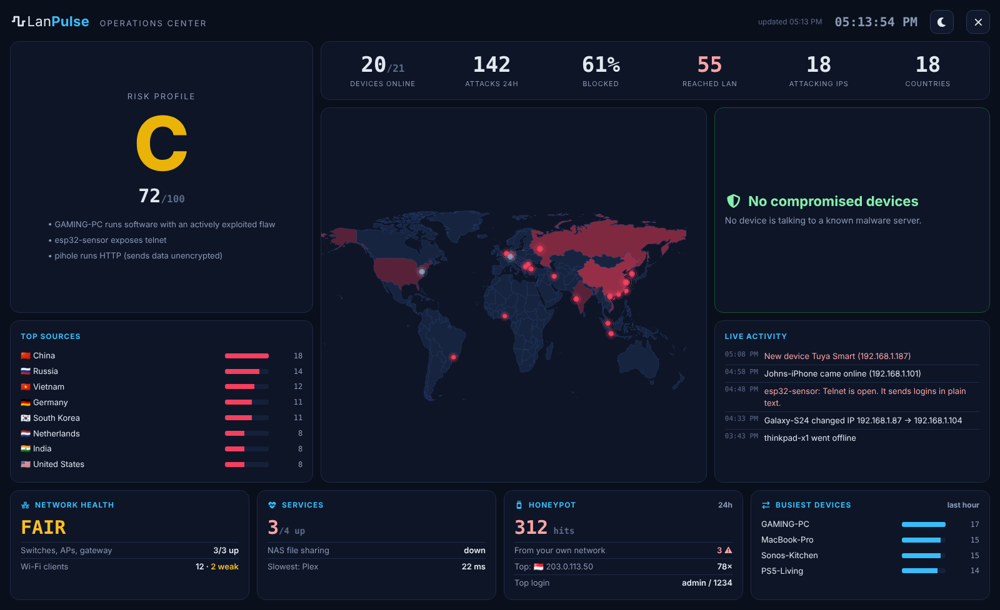
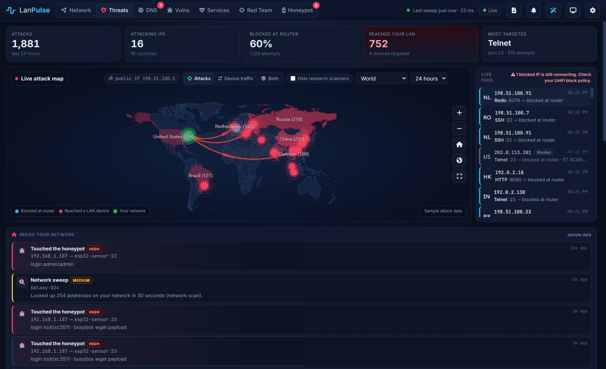
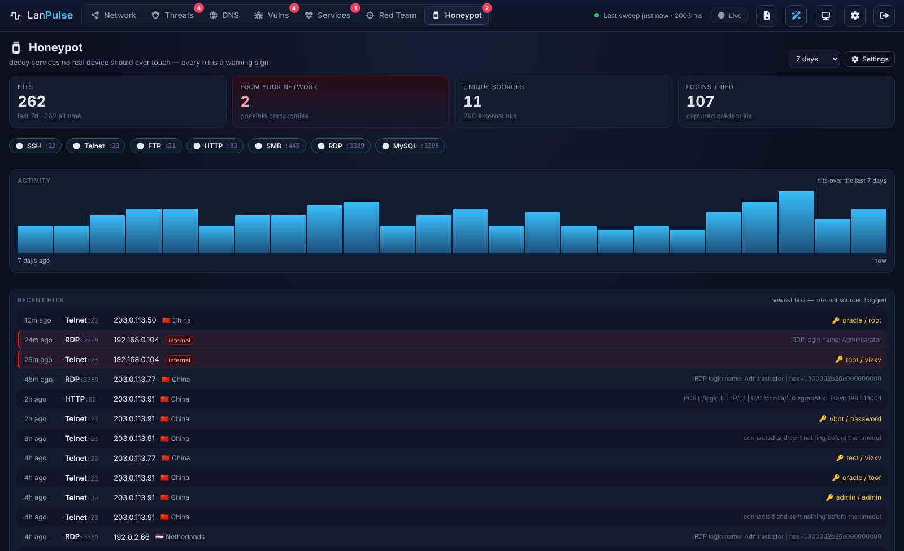
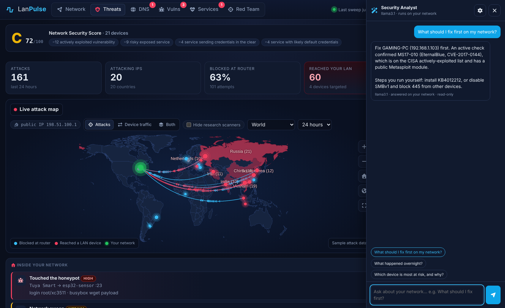
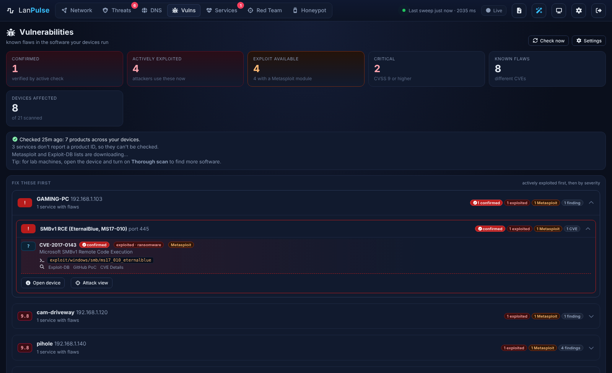

# LanPulse

**Real-time LAN mapper and security dashboard** — a self-hosted, live view of your home or lab network, viewed from
any browser. Discover every device, watch attacks on a live world map, scan for vulnerabilities, and get an at-a-glance
security score and an alert the moment something inside your network is compromised.

> **Project page with full feature tour and screenshots:** https://r00tb0ss.github.io/LanPulse/









Licensed under **GPL-2.0-or-later**. Runs on Ubuntu, Debian or a 64-bit Raspberry Pi.

## Features

- **Live map** of every device on your LAN, updated every 10 seconds
- **Device-type icons**: router, access point, PC, Mac, phone, tablet, printer, TV, camera, NAS, console, smart speaker, IoT, Raspberry Pi, server and more
- **Device details**: IP, MAC, vendor, hostname, latency, OS guess, open ports (web ports are clickable), first/last seen and IP history
- **24-hour history** for each device: an uptime bar and a latency chart (kept for 7 days)
- **Trusted devices**: anything new shows a red dashed ring until you trust it
- **Watched devices**: get an alert when an important device goes offline or comes back
- **Threats view**: live world attack map of who is hitting your public IP, which LAN device they target, and an investigation panel for each attacker (location, ISP/ASN, abuse score, Shodan data, what they tried, block rules)
- **Six map views**: star, grouped by type, tree, rings, tiles and a sortable table
- **Inside-the-LAN detection**: network sweeps (nmap/Fing), router impersonation (ARP spoofing), IP conflicts, port scans against the LanPulse server, and any LAN device touching a honeypot
- **One-click blocking** of attackers on your UniFi gateway (UDM, UDM Pro, UCG) through an IP group
- **Research-scanner tagging**: Shodan, Censys, Shadowserver and others are verified by forward-confirmed reverse DNS (plus GreyNoise) and shown in grey
- **IPS view**: what your UDM's intrusion prevention recognized (Mirai, router exploits, SSH scans...)
- **Honeypot**: built-in decoy Telnet, FTP, SMB, RDP and MySQL (optional SSH and HTTP) that log probes and credentials; a hit from inside your LAN flags a likely-compromised device
- **Confirmed vulnerabilities**: safe active checks (nmap NSE) prove flaws version matching misses, such as EternalBlue on unpatched Windows, ranked above version guesses
- **AI Security Analyst**: ask questions in plain language using Ollama, any OpenAI-compatible server or Anthropic; read-only and grounded in your own data
- **Daily summary** to any alert channel
- **Device traffic on the attack map**: live arcs showing where each device connects (Google, Netflix, Amazon...), top destinations and busiest devices, and an alert when a device contacts an IP that attacked you
- **Security warnings** for risky services: Telnet, VNC, FTP, exposed databases, Docker API, old SSH, HTTP-only admin pages
- **Alerts** by ntfy push, Telegram, webhook (Discord, Slack, Home Assistant), email or IRC
- **Login** with a hashed password, plus optional HTTPS
- **Works offline**: map and icon libraries are stored locally
- Wake-on-LAN, saved map layout, CSV export, search and filters, and it works on phones

## Install (Ubuntu 22.04 / 24.04)

```bash
unzip lanpulse.zip && cd lanpulse
sudo ./install.sh
```

The installer asks whether you want a login and HTTPS. Then open `http://<ubuntu-ip>:8080` (or `https://`) from another computer on the same network.

Re-running `install.sh` upgrades LanPulse and keeps your devices, history and settings.

## First steps

1. Devices found in the first scan are trusted automatically. Anything that joins later shows a red dashed ring.
2. Click the gear icon, then **Where to send**, turn on a channel and press **Save & send test**.
3. Open important devices (NAS, cameras, server) and press **Watch** to be told when they go offline.
4. Arrange the map, press the lock icon to freeze it, then the save icon to keep that layout for everyone.

## Attack map (Threats view)

LanPulse can't see internet traffic by itself, so it listens to sources that do:

1. **Router firewall logs (recommended).** In your router, log blocked inbound (WAN) traffic and send it to remote syslog at the LanPulse machine's IP, **UDP port 514**.
   - OpenWrt: System > Logging > External system log server, and enable logging on the WAN zone (Network > Firewall > Zones > wan > Enable logging).
   - pfSense / OPNsense: Status > System Logs > Settings > Remote logging, include Firewall events.
   - UniFi: Settings > CyberSecure / System Logging > SIEM server (syslog), and enable firewall logging on rules.
   - MikroTik: `/system logging action add name=nm target=remote remote=<ip>` plus a logging rule for `firewall`.
   - Linux/UFW routers: forward kernel logs with rsyslog.
2. **Honeypot or script.** POST JSON to `/api/threats/ingest` with header `X-API-Key` (key is in Settings > Threats):
   ```json
   {"src": "203.0.113.9", "dst_port": 23, "service": "telnet", "detail": "login root/admin",
    "sensor": "esp32-honeypot", "lan_ip": "192.168.1.50"}
   ```
   Send one object or a list. Honeypot hits show as "Honeypot" and don't trigger "attack reached" alerts.
3. **Port forwards.** List them in Settings > Threats so attacks on forwarded ports are tied to the right device.

Attackers are placed on the map with the free DB-IP City Lite database (refreshed monthly). Investigating an IP also queries ip-api.com, Shodan InternetDB and, if you add a free key, AbuseIPDB. Attack data is kept for 30 days.

## Device traffic layer

Switch the attack map to **Device traffic** or **Both** to see where your devices connect. It needs your router to log new outbound connections. On a UDM, create one policy in Settings > Policy Engine: Action Allow, Source zone Internal, Destination zone External, Connection state New, Syslog Logging on. Destination owners and locations come from the free DB-IP ASN Lite and City Lite databases (attribution: IP Geolocation by DB-IP, https://db-ip.com). Traffic is stored as per-minute totals for 7 days.

## One-click blocking on UniFi

1. In UniFi, create an API key (Settings > Control Plane > Integrations) and paste it in LanPulse under Settings > UniFi. A local-only admin account also works.
2. Press **Save & test**, then block any attacker from its panel. That creates the IP group **LanPulse Blocklist** on the gateway.
3. In UniFi's Policy Engine, create one policy: Source zone External with the IP group *LanPulse Blocklist*, Destination any, Action Block.

From then on, **Block on UDM** in an attacker's panel takes effect immediately. **Unblock** removes the address again.

## Threats inside your network

LanPulse watches ARP traffic (which every device broadcasts) and connections to its own server. It flags a device that looks up many addresses quickly (a network scan), claims to be your router (ARP spoofing), shares an IP with another device, or port-scans the LanPulse server. Honeypot hits and UDM IPS events from LAN addresses also appear here. Devices that legitimately scan, such as a phone running Fing, can be allowed from their device panel. Thresholds are in Settings > Threats.

**Router impersonation.** LanPulse learns your router's hardware address from its own scans (never from traffic it
overhears, which an attacker could send first) and then checks it on every sweep, in ARP traffic it sees, and in this
server's own ARP table. Anything else answering for the router's IP is reported and is never shown as the router on the
map. If you replace the router, LanPulse accepts the new one after the old one has been gone for an hour (with an alert),
or straight away with **Learn it again** in Settings > Threats.

**Rogue DHCP servers.** LanPulse watches the DHCP replies it overhears. You can also have it send a DHCP "discover"
every 15 minutes (Settings > Threats; off by default). It uses its own made-up hardware address (02:4C:50:…), never the
server's, and never requests an address. A DHCP server other than your router is reported with
the router and DNS server it hands out, since a rogue one can send devices to a fake gateway. If you run a second DHCP
server on purpose (a Pi-hole, say), add it under Settings > Threats > Allowed DHCP servers.

**Port changes.** After each port scan LanPulse compares the result with the last one. A newly opened port sends an
alert (higher priority for risky ones, and for classic backdoor ports such as 4444 or 31337); closed ports and software
version changes go on the device's timeline. A scan that suddenly finds nothing open isn't believed until the next scan
agrees, and switching a device between quick and thorough scans doesn't count as a change.

### Lateral movement

A device that tries to reach **5 or more different machines** on admin ports (SSH, Telnet, SMB, RDP, WinRM, VNC,
databases, NFS) within 10 minutes is flagged as **Possible lateral movement**, which is how an intruder spreads from
the first machine they break into. The threshold is adjustable in Settings > Threats.

LanPulse can only flag what it can see. It sees connections that your router logs between networks or VLANs
(on a UniFi gateway, enable logging on the inter-VLAN allow/block policies) and any traffic that reaches the LanPulse
server's network card, for example from a switch **mirror port**. Machines on the same switch talk directly, so
without a mirror port that traffic is invisible to any tool on the network, and the honeypot is the best tripwire.

## Device timeline

Each device panel has a **Timeline**: when it joined, came online or went offline, changed IP, opened or closed ports,
changed software versions, gained or lost vulnerabilities, triggered a threat, and the changes you made (trusting it,
renaming it, accepting a risk). Filter it by kind; the default hides online/offline. Kept for 90 days.

## Alert channels

| Channel | What you need |
|---|---|
| ntfy | A topic URL such as `https://ntfy.sh/your-secret-topic`. Install the ntfy app and subscribe to the same topic. |
| Telegram | Create a bot with @BotFather for the token. Message the bot, then get your chat ID from `https://api.telegram.org/bot<token>/getUpdates`. |
| Webhook | A Discord or Slack webhook URL, or any URL that accepts JSON. |
| Email | SMTP server, port (587 STARTTLS or 465 SSL), username and password. Gmail needs an app password. |
| IRC | Server, port, nickname and channel. Turn off certificate checks for a self-signed server. |

## Options

Everything is set in the dashboard under **Settings > System**: how often devices are checked, when they count as
offline, port and OS scans, how many ports a quick scan checks, how often devices are re-scanned, parallel scans, the
network interface and subnet, and the web server's port, HTTPS and listen address. Scanning changes apply right away;
network and web server changes apply after you click **Restart now** there. Devices can also get a **Thorough scan**
(all 65,535 ports) from their panel.

`/etc/default/lanpulse` now only names the data folder. Options from older versions are moved into Settings > System
automatically the first time the new version starts (or when you re-run `install.sh`).

Locked out after changing the port or HTTPS? On the LanPulse machine:

```bash
sudo /opt/lanpulse/venv/bin/python /opt/lanpulse/app.py --data-dir /opt/lanpulse/data --reset-web
sudo systemctl restart lanpulse
```

That sets the web server back to `http://<this-ip>:8080` and keeps everything else.

Change the login from the command line:

```bash
sudo /opt/lanpulse/venv/bin/python /opt/lanpulse/app.py --data-dir /opt/lanpulse/data --set-password
```

## Try it without scanning

```bash
python3 -m venv venv && ./venv/bin/pip install -r requirements.txt
./venv/bin/python app.py --demo --port 8080 --data-dir ./demo-data
```

## How it works

- **Presence**: ARP sweep with Scapy (finds devices that block ping).
- **Details**: nmap service and OS detection runs in the background on new devices and every hour after.
- **Names**: reverse DNS, mDNS (Avahi) and NetBIOS.
- **Vendors**: nmap's MAC prefix database.
- **Storage**: `/opt/lanpulse/data` holds devices, settings, history (SQLite) and the login.

Notes: it runs as root for ARP and OS detection. The map draws a star around your gateway, which shows what is on the network rather than physical cabling. Wake-on-LAN needs it enabled in the target PC's BIOS and network settings.

Only scan networks you own or are allowed to scan.

## DNS (Pi-hole)

The **DNS** tab shows what every device looks up, read from your Pi-hole's query log (Pi-hole v6, or v5 with its API
token): lookups and blocks over time, top domains, top blocked domains, a live list, and lookups per device. Each lookup is
checked against the abuse.ch URLhaus malware host list; a device looking up a malware domain raises an alert.
Connect it from the DNS tab (address + password; Pi-hole's "App password" is the cleanest). If almost every lookup comes
from your router, hand out Pi-hole as the DNS server directly (UniFi: Settings > Networks > DHCP > DNS Server) so Pi-hole
can tell devices apart. Lookups are kept as per-minute totals for 7 days.

## Vulnerabilities

The **Vulnerabilities** tab matches the software versions found by the port scan against the NVD database, ranks flaws
on CISA's Known Exploited Vulnerabilities list first, and lists LanPulse's own findings (risky open services, end-of-life
Windows) beside them. Only product names (like "openbsd openssh") are sent to NVD. Without an NVD API key, the first
check takes about 7 seconds per product; a free key (Settings on that tab) makes it about 8 times faster. Results are
cached for a week. Matching is by version number, so Linux packages that were patched without a version change can show
up as "may be patched". An alert goes out when a device gains an actively exploited flaw.

Each flaw is also checked against the Metasploit module list and Exploit-DB, and flaws with public exploit code rank
first, with the module names shown. LanPulse recognises common server software by name when nmap gives no product ID,
and when it knows the software but not the exact version it lists only the flaws that have a Metasploit module or are
actively exploited, marked "version unknown". For lab machines and servers, turn on **Thorough scan** in the device's
panel: it checks all 65,535 ports with full version detection (a few minutes per device) and finds much more.

Old Windows is checked as an operating system too (Windows NT, 2000, XP, Server 2003, Vista, 7, Server 2008 and
2008 R2), using nmap's OS guess and the version Windows announces over file sharing. A scan can't see which Windows
updates are installed, so these list only flaws with a Metasploit module or on CISA's exploited list, marked
"patch level unknown". Newer Windows is left out for the same reason: it is patched monthly.

### Confirmed findings (active checks)

Version matching can't see which patches are installed, so on **Thorough scans** LanPulse also runs nmap's safe
vulnerability scripts (for example `smb-vuln-ms17-010` for EternalBlue, plus checks for Heartbleed, POODLE and others)
and reads the Windows version from `smb-os-discovery`. Each finding carries a confidence tier: **Confirmed** (an active
check proved it), **Version match**, or **OS guess**. Confirmed findings rank first, show a Confirmed count and badge
on the Vulnerabilities tab, and weigh heavily in the Risk Profile. The checks are non-intrusive and exploit nothing.

Thorough scans also run nmap's `vulners` script, which looks up each detected service version at vulners.com and
adds serious (CVSS 7+) CVEs the NVD match missed. These are version-based, so they rank as **Version match**, not
Confirmed. Only the service's version identifier (CPE) is sent to vulners.com, never your IPs or device names; if the
LanPulse box has no internet access, the lookup is simply skipped.



## Honeypot

The **Honeypot** tab runs decoy services that no real device should ever touch. It is **off by default**; turn it on
under Settings on that tab. Telnet, FTP, SMB, RDP and MySQL are on by default; SSH and HTTP are optional (they need
their ports free). Every connection is logged with the credentials tried. Hits are split into **internal** (a device
on your LAN touched a decoy: likely compromised, alerts immediately) and **external**. External sensors, such as an
ESP32 honeypot, can post events to `/api/honeypot/ingest` using the ingest key shown in settings.

The honeypot is low-interaction: it speaks just enough of each protocol to collect logins, never gives a shell or real
access, caps its logging under floods and escapes everything it records.


## AI Security Analyst

The wand button in the top bar opens a chat that answers questions about your network ("What should I fix first?",
"What happened overnight?"). It is **off by default**. Choose a provider from the gear icon, press **Test**, then **Save
& enable**:

| Provider | Server address | Notes |
|---|---|---|
| Ollama | `http://localhost:11434` | Local; nothing leaves your network |
| OpenAI-compatible | `http://localhost:1234/v1` | LM Studio, vLLM, LocalAI, Groq, OpenRouter, OpenAI... needs an API key if hosted |
| Anthropic | `https://api.anthropic.com` | Needs an API key; a network summary is sent to Anthropic |

The analyst is strictly read-only: it sees a capped summary of what LanPulse already knows (risk profile, devices and
ports, vulnerabilities, threats, recent events), cites it in answers, and can only explain; for fixes it gives steps for
you to run. Device names and banners are treated as untrusted data. With a cloud provider, that summary is sent to
them with each question, and the panel says so. API keys are stored on the LanPulse box and masked in settings.


## Risk Profile (network security score)

A single **A–F grade** (0–100) for the whole network, shown at the top of the Red Team tab and in NOC mode. It rolls up
compromised devices, actively-exploited and exploitable vulnerabilities, end-of-life operating systems, default-credential
and cleartext services, risky exposed ports and untrusted devices. A **daily history** is kept so you can watch it climb as
you fix things, and the **Fix list** shows exactly what's costing you points, worst first. It's a prioritisation aid, not a
certification.

## Compromised-device detection

LanPulse cross-references your devices' **outbound** connections (from the firewall log) against abuse.ch's **Feodo Tracker**
list of known botnet command-and-control servers (free, no key). If one of your own devices connects out to a known C2, it's
flagged as **possibly compromised** — the strongest signal here that a device is infected. Most tools only watch inbound
attacks; this catches an already-infected device phoning home.

## Behavior anomalies

LanPulse learns each device's normal outbound behavior and alerts on deviations, after a 24-hour learning window:
- **New region** — a device connects to a country it has never talked to before ("your thermostat is now reaching Russia").
- **Traffic spike** — a device's outbound volume in the last hour is far above its own 7-day norm (possible exfiltration or
  beaconing).

## Wall-display (NOC) mode

The **screen icon** in the top bar opens a full-screen operations-center view for a TV or second monitor: the big security
grade, live stat tiles, the attack map, a compromised-device banner, a live activity feed and top attack sources, all
auto-refreshing. Press **Esc** to exit.

## Themes

**Settings → Appearance** offers four looks: **Midnight** (the default dark), **Enterprise Light** (clean white),
**80s Hacker** (green phosphor on black) and **Midnight Synthwave** (neon magenta and cyan). The choice is saved in your
browser.

## Red Team

The **Red Team** tab turns what LanPulse already found into an offensive-recon workflow — it maps and plans only, and
**never runs an exploit**. Everything is built from data already scanned, so it adds no new traffic to your devices.

- **MITRE ATT&CK mapping** — open ports, services and vulnerabilities are mapped to ATT&CK techniques, grouped by tactic.
- **Metasploit hand-off** — each vulnerability with a module gets its `use` / `set RHOSTS` / `set RPORT` lines, with a
  copy button in the device panel. You run them yourself in your own `msfconsole`. LanPulse generates the text only, from
  module names it already identified, and device banners can never become commands.
- **Exports:**
  - **Metasploit resource script** (`.rc`) — pre-configures every exploitable finding; run with `msfconsole -r lanpulse.rc`.
    The `run` line for each module is left commented out, so nothing fires until you uncomment it.
  - **Nmap XML** — the stored scan as an nmap file, to `db_import` into Metasploit or another tool.
  - **Engagement report** (HTML) — findings per host with ATT&CK, open ports, vulnerabilities and severity, for a writeup.
- **Default-credential flagging** — services that commonly ship with default logins are flagged for you to check by hand.
  LanPulse never attempts a login.

- **MITRE ATT&CK, in depth** — click any technique for a built-in summary (what it is, why it mapped to your network,
  which hosts, detection and mitigation), plus a link to its full MITRE page. Export an **ATT&CK Navigator layer** (`.json`)
  to see your findings as the classic technique heatmap at mitre-attack.github.io/attack-navigator.
- **Exploitability score** — each host gets a 0-100 score from exploit availability and exposure, so the targets to look
  at first are obvious. It's a planning aid, not a measurement.
- **Cleartext-credential exposure** — open services that send logins in the clear (telnet, FTP, HTTP logins, POP3/IMAP,
  SNMP) are flagged, since a sniffer on the path could read them.
- **Per-CVE research links** — each vulnerability links out to Exploit-DB, a GitHub proof-of-concept search and CVE Details.

Use this only against systems you own or are explicitly authorised to test.

## Attacker intelligence (OSINT)

For the remote IPs attacking you (Threats tab → click an IP → Investigate), LanPulse gathers passive threat intelligence
from free sources — it never scans or connects back to the attacker.

- **Already included:** location and network owner (ip-api), reputation (AbuseIPDB, with your key), known-scanner labelling
  (GreyNoise), and what a scanner already recorded about the IP (Shodan InternetDB).
- **ThreatFox (abuse.ch)** — is the IP a known malware command-and-control or botnet address? Free, no key.
- **Tor exit node** — is the attacker coming through Tor? LanPulse keeps a daily copy of the exit-node list.
- **Auto-enrich** — your worst recent attackers are looked up in the background (Settings → Threats, on by default) so the
  intel is ready when you open them. It's throttled to be gentle on the free services.
- **IOC export** — download the attacker IPs as a plain block list (all, or only those that reached a LAN device) for your
  firewall or to share (Settings → Threats).

## Services

The **Services** tab is an up/down board: web pages (HTTP/HTTPS), open ports (TCP) and ping, each on its own interval,
with 24-hour and 7-day uptime, response times, an availability strip and outage history (30 days). After two failed checks in a row
a service counts as down and you get an alert, and another when it recovers. LanPulse suggests checks for things it
found (Plex, Pi-hole, your router, Proxmox, Home Assistant and more).

## Updating

**From the dashboard:** download `lanpulse.zip` from the [latest release](https://github.com/r00tb0ss/LanPulse/releases/latest), then Settings > Update, choose it, check the version shown, and click Install.
LanPulse backs up the current version, installs the update, restarts, and reloads the page. If the install fails,
the previous version is restored automatically and the log is shown. Updates need a dashboard login, because they
run with administrator rights. The web app itself can't change its own files: a separate root-only helper
(`lanpulse-update.path` / `lanpulse-update.service`) does the install when you click Install.

**From the terminal:** `unzip -o lanpulse.zip -d ~ && cd ~/lanpulse && sudo ./install.sh`
(add `--upgrade` to skip all questions). Your devices, history, settings, login and certificates are kept either way.

## Security

- **Set a login and use HTTPS.** The installer offers both. Without HTTPS, your password crosses the network in plain text.
- **Without a login,** LanPulse only answers to IP addresses and local names (`.lan`, `.local`, single-word names). This blocks
  DNS-rebinding attacks from web pages you visit. To use a real domain name, add it under Settings > System >
  Extra host names.
- **Changes from other web sites are refused.** Requests and live connections that come from another site (CSRF,
  cross-site WebSocket) are rejected.
- **Router logs are only accepted from your gateway** and addresses you allow (Settings > Threats). Syslog has no password,
  so this stops other devices from feeding in fake attacks. A device that forges the gateway's address can still get
  through, so treat attack data as information, not proof.
- **Names devices announce about themselves** (DHCP, mDNS, UPnP) are cleaned of control and invisible characters, and
  CSV exports are protected against spreadsheet formula injection.
- **The service runs in a systemd sandbox:** the system is read-only to it except its data folder, and it keeps only
  the network permissions it needs. If your system can't start it that way, the installer falls back and says so.
  To turn the sandbox off yourself: `sudo mv /etc/systemd/system/lanpulse.service.d/hardening.conf{,.off}` then
  `sudo systemctl daemon-reload && sudo systemctl restart lanpulse`.
- **Updates from the dashboard run with administrator rights.** They need a login, the root-only helper re-checks every
  zip (only plain files inside a `lanpulse` folder: no links, nothing outside it) and backs up the current version first.
  Anyone who can log in can install an update, so use a strong password. To turn dashboard updates off on the machine
  itself: `sudo mv /etc/lanpulse/web-updates /etc/lanpulse/web-updates.off` (terminal installs still work).
- **Web server and network settings, and restarting, need a login,** so nobody else on your network can lock you out.
  LanPulse also refuses a port that another program already uses.
- **UniFi:** use a local-only admin account. LanPulse doesn't verify the UDM's self-signed certificate by default, so
  someone already inside your network could intercept that login.

## License

LanPulse is free software: you can redistribute it and/or modify it under the terms of the
**GNU General Public License as published by the Free Software Foundation, either version 2 of the License, or
(at your option) any later version.** See [`LICENSE`](LICENSE) for the full text.

LanPulse is distributed in the hope that it will be useful, but WITHOUT ANY WARRANTY; without even the implied warranty
of MERCHANTABILITY or FITNESS FOR A PARTICULAR PURPOSE. See the GNU General Public License for more details.

Third-party software, data and services used by LanPulse keep their own licenses. See
[`THIRD-PARTY-NOTICES.md`](THIRD-PARTY-NOTICES.md). IP geolocation by [DB-IP](https://db-ip.com).
